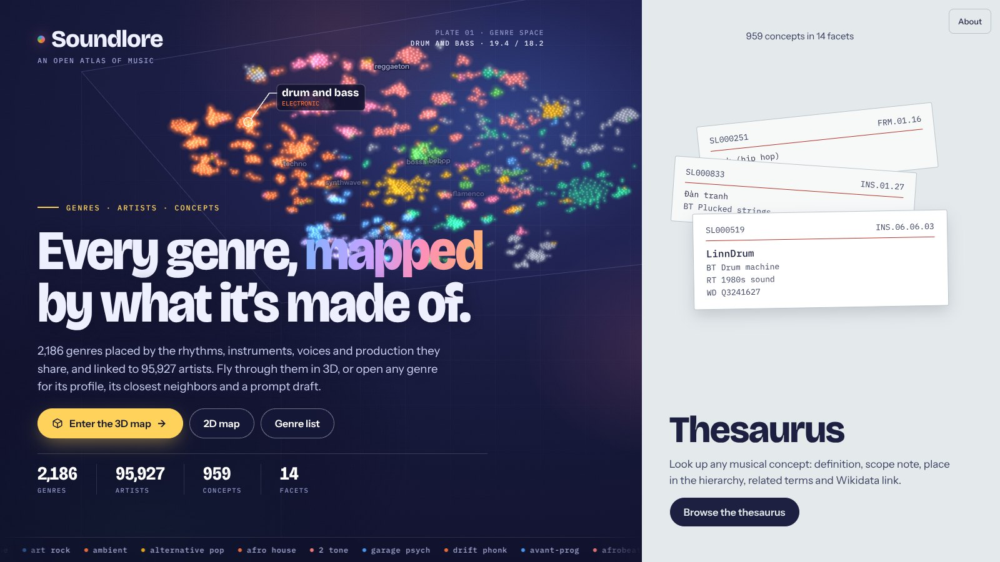
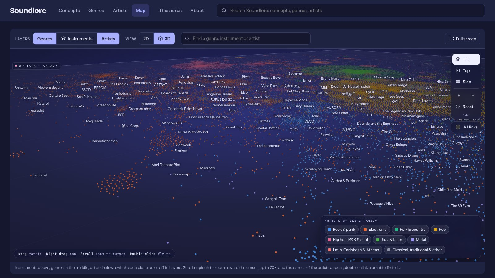
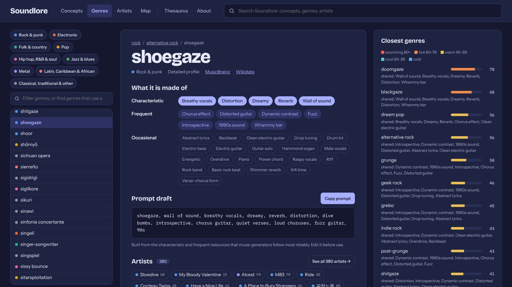
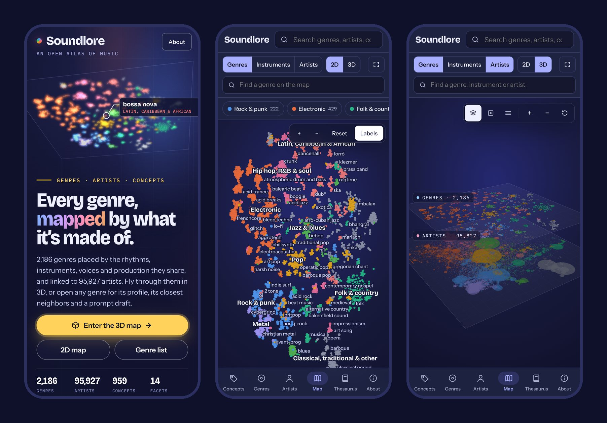

  

<h1 align="center">Soundlore</h1>

<b>An open atlas of music: every genre, mapped by what it’s made of.</b>

  <a href="https://aydearcas.github.io/Soundlore/"><b>Open Soundlore →</b></a> ·
  <a href="https://aydearcas.github.io/Soundlore/explore.html#map-3d-artists">3D map</a> ·
  <a href="https://aydearcas.github.io/Soundlore/explore.html#genres">Genres</a> ·
  <a href="https://aydearcas.github.io/Soundlore/explore.html#artists">Artists</a> ·
  <a href="https://aydearcas.github.io/Soundlore/thesaurus.html">Thesaurus</a> ·
  <a href="https://aydearcas.github.io/Soundlore/about.html">How it works</a>

2,186 genres · 95,927 artists · 959 musical concepts · 14 facets · free and open data

---

## What is Soundlore?

Soundlore describes music by **what it is made of**: the rhythms, instruments, voices, harmonies, production techniques and moods that a song can use. It records which of those resources define each musical genre and, from that, measures how close two genres are. The result is a map you can explore, in 2D or in 3D, where genres that sound alike sit near each other and every artist is placed among the genres they play.

It is built for curious listeners, musicians, students, music teachers and researchers, and for anyone who writes prompts for AI music generators and wants the right words for a sound.

No account, no installation: it runs in the browser, on a computer or a phone.

## What you can do

- **Fly through the map of genres in 3D.** Genres sit on one plane and almost 96,000 artists on another, joined by lines. Zoom in (up to 70×) and the names of the artists appear; double-click any point to fly to it.
- **Open any genre** to see what it is made of (characteristic, frequent and occasional resources), its closest genres with a 0–100 “temperature”, its best-known artists, where it comes from and a ready-to-edit **prompt draft** for music generators.
- **Look up an artist** to see their genres, what those genres are made of and similar artists.
- **Browse the thesaurus**: 959 musical concepts, from *blast beat* to *Dorian mode* or *wall of sound*, each with a definition, its place in the hierarchy, related terms and a Wikidata link.
- **Search everything at once** (genres, artists and concepts) from the box at the top of every page.
- **Share any view**: every genre, artist, concept and map view has its own address.

  
   Zoomed into the artist layer of the 3D map: names appear as you get closer.

  
   A genre record: what shoegaze is made of, a prompt draft and its closest genres.

  
   Designed for phones too, with a bottom tab bar and a full-screen map.

## How it works, in short

1. **Concepts.** A thesaurus of 959 musical resources in 14 facets (rhythm, harmony, form, voice, instruments, production, mood…), each with a stable identifier (`SL000081`), a definition and links to Wikidata.
2. **Genre profiles.** Each of the 2,186 profiled MusicBrainz genres lists which of those resources are characteristic, frequent or occasional in it.
3. **Temperature.** Two genres are “hot” (close) when they share resources, especially rare ones, and when they are near each other in the MusicBrainz genre tree.
4. **The map.** Genres are placed so that hot pairs sit close together; artists are placed at the centre of their genres, weighted by the MusicBrainz community’s votes or, for some, by their Wikidata genres.

The [About page](https://aydearcas.github.io/Soundlore/about.html) explains each step in detail, with its sources and limits.

## Status

Soundlore is a work in progress (v0.11). The definitions and many genre profiles are drafts written with the help of AI assistants and still need expert review; the [Limits](https://aydearcas.github.io/Soundlore/about.html#limits) section on the About page lists what to keep in mind. Corrections and suggestions are welcome through [GitHub issues](https://github.com/aydearcas/Soundlore/issues).

## Data, license and credits

- **Code** (build scripts and site): [AGPL-3.0](LICENSE).
- **Soundlore’s own data** (concepts, definitions, genre profiles, temperature, map): CC0, free for any use.
- **MusicBrainz and Wikidata core data**: CC0. **Artist–genre links derived from MusicBrainz votes**: CC BY-NC-SA 3.0, kept in separate files. Details in [License](#license) and [DATA-LICENSE.md](DATA-LICENSE.md).
- Genres, artists and instruments come from [MusicBrainz](https://musicbrainz.org/) and [Wikidata](https://www.wikidata.org/); thanks to both communities.

**General Orchestrator:** aydearcas ([GitHub](https://github.com/aydearcas), [LinkedIn](https://www.linkedin.com/in/aydearcas/)), with Claude (Anthropic) and ChatGPT (OpenAI) as AI assistants.

---

# Technical documentation

Everything below is for people who want to rebuild the data, change the site or reuse the files.

> The site is in `viewer/`. On every push to `main`, the GitHub Actions workflow `.github/workflows/pages.yml` runs `build/package.py`, which validates the site and copies it to `dist/`, and publishes it to GitHub Pages. Generated files in `build/` are not committed: run the build to recreate them. The 1.7 GB MusicBrainz artist dump is not committed either; its extract (`sources/musicbrainz/artist_genres_extract.jsonl.gz`) is.

Soundlore is both a visualization tool and a library of musical lore, genres, artists and resources plus concepts organized as a thesaurus (SKOS model, MeSH style), with two connected vocabularies:

1. **Concepts** (musical resources), in 14 facets.
2. **Genres**: all 2,212 MusicBrainz genres, with their relations.

A third layer, **artists** (95,927 MusicBrainz artists: 48,127 selected by their MusicBrainz genre votes and 47,800 added from Wikidata), sits outside the thesaurus: each artist is linked to genres by the MusicBrainz community genre votes, and its description, map position and similar artists are derived from those links (see Artists).

The bridge between them is each genre's **profile**: which resources are characteristic (C), frequent (F) or occasional (O) in it. The **temperature** between genres is computed from that bridge.

## Folder layout

| Path | Contents |
|---|---|
| `concepts/*.txt` | Editable concept sources (one line per concept; indentation sets the hierarchy) |
| `concepts/ids.tsv` | Registry of stable concept identifiers (`SL000001`…); never edited by hand except the `note` column |
| `concepts/definitions_en.tsv` | English definition of each concept, keyed by identifier |
| `concepts/wikidata.tsv` | Wikidata item and English Wikipedia article of each concept, keyed by identifier |
| `concepts/facets_en.md` | Description of each facet: a one-sentence summary and a short article (see Facets) |
| `concepts/musicbrainz_instruments.tsv` | Crosswalk from Instrumentation concepts to MusicBrainz instruments, keyed by identifier |
| `concepts/translations_es.tsv` | Spanish labels and synonyms, kept as an optional translation layer (not used by the build) |
| `genres/core.txt` | Genres in the core set (profiled in more detail) |
| `genres/profiles_*.txt` | Genre → resource profiles (editable source) |
| `sources/musicbrainz_genres.json` | Original MusicBrainz download (genre list + each genre's relations) |
| `sources/musicbrainz/instrument.tar.xz` | MusicBrainz instrument dump (JSON dump 20261010-001001, CC0) |
| `sources/musicbrainz/artist.tar.xz` | MusicBrainz artist dump (JSON dump of 2026-10-10, ~1.7 GB; not needed once the extract exists) |
| `sources/musicbrainz/artist_genres_extract.jsonl.gz` | The 214,970 artists with at least one genre vote, from `build/filter_artists.py` (genre votes CC BY-NC-SA 3.0); `.meta.json` and `artist_genres_counts.txt` hold the dump date and the counts by vote threshold |
| `sources/ChatGPT/` | ChatGPT drafts used as inputs: facet descriptions, gap review |
| `work/splits/` | One file per concept split: every reference to the old entry and the decision taken |
| `work/gap_review/` | Gap review: phase A log and phase B decision tables |
| `work/chatgpt_profiles/` | Inputs and proposals for completing the low-confidence profiles |
| `work/claude_profiles/` | Claude's working files for those proposals and `compile.py`, which validates them |
| `build/*.py` | Scripts that validate the sources and generate the JSON |
| `build/ids.py` | Issues identifiers; renames or retires a concept without losing its identifier |
| `build/check_links.py` | Re-verifies the Wikidata and Wikipedia links against both APIs |
| `build/export_skos.py` | Exports the concept thesaurus as SKOS (`build/soundlore.ttl`, `build/soundlore.jsonld`) |
| `build/sync_viewer.py` | Copies the generated data files the site reads from `build/` to `viewer/` |
| `build/concepts.json` | Generated concept thesaurus |
| `build/genres.json` | Generated genre thesaurus |
| `build/temperature.json` | The 25 closest genres for every genre |
| `build/genres_by_concept.json` | Inverted index: which genres use each resource |
| `build/genre_map.json` | 2D coordinates and family of every profiled genre, for the map view |
| `build/stats.json` | Counts and sample records for the landing page |
| `viewer/index.html` | Landing page: two doors, to the explorer (3D map) and to the thesaurus |
| `viewer/og-image.jpg` | Preview image shown when a link to the site is shared |
| `docs/images/` | Screenshots used in this README and `social-preview.jpg` for the repository's social preview |
| `viewer/explore.html` | Explorer: concepts, genres (profiles, prompt drafts, temperature) and the genre map |
| `viewer/thesaurus.html` | Thesaurus: MeSH-style concept records, A–Z index, search, SKOS export |
| `viewer/layers.html` | The layered map: instruments, genres and artists, linked; 2D or 3D |
| `build/build_layers.py` | Builds `instrument_layer.json` for that view |
| `build/filter_artists.py` | Streams `artist.tar.xz` (no decompression to disk) and keeps the artists with genre votes; `build/run_filter_artists.bat` runs it on Windows with a double click |
| `build/build_artists.py` | Selects the artists, places them on the map and computes similar artists: `build/artists.json`, `build/artist_neighbors.json`, `build/artists_stats.json` (needs `numpy`) |
| `viewer/about.html` | About: the project, the methodology (concepts, profiles, temperature, map), sources and credits, limits |

To rebuild: `python build/build_concepts.py && python build/export_skos.py && python build/build_genres.py && python build/verify.py && python build/build_map.py && python build/build_layers.py && python build/build_artists.py --min-votes 2 --wd-total 2 --wd-sitelinks 3 && python build/sync_viewer.py` (the map needs `numpy` and `scikit-learn` and the artists `numpy`; the other scripts only the standard library). If no profile changed, `build_map.py` can be skipped. `filter_artists.py` runs only when a new artist dump is downloaded.

## The site

Four static pages in `viewer/`, with no framework and no build step. Each page loads only the data it needs, and every view has its own address.

| Page | Addresses | Contents |
|---|---|---|
| `index.html` | | Landing page. The left two thirds are a cover: the genre map drawn as a slowly turning plate, the headline, the figures and a ticker of genre names; the main button and the map open the 3D view with genres and artists (`explore.html#map-3d-artists`), other buttons the 2D map and the genre list. The right third shows catalog cards and opens the thesaurus. They stack on phones. |
| `explore.html` | `#concepts/SL000081`, `#genres/shoegaze`, `#artists/<MBID>`, `#artists/genre/shoegaze`, `#map/shoegaze`, `#map-instruments`, `#map-3d/shoegaze`, `#search/<text>` | Concepts tab (tree, definition, prompt terms, genres that use the concept), Genres tab (profile, prompt draft, the genre's most voted artists, relations, closest genres, mini-map), Artists tab (list with family and genre filters; record with voted genres, the resources of those genres, prompt draft, similar artists and a mini-map joining the artist to its genres) and the map. The header search looks across concepts, genres and artists (`#search/<text>` lists everything); each list has its own filter box above it. The map card has one toolbar for the layer (genres or instruments), the view (2D or 3D), a find box and full screen; the instrument layer and the 3D view are `layers.html` embedded in the card. |
| `layers.html` | `#g/shoegaze`, `#i/SL000127`, `#3d`, `#3d/g/shoegaze`, `#embed/…` | Linked layers (genres, instruments, artists) in 2D or 3D (three.js r128 from cdnjs). In 3D the wheel or a pinch zooms toward the cursor up to 70×, the names of genres and artists in view appear close up, double-click flies to a point, and a camera dock has Tilt / Top / Side views, zoom buttons and reset. `#embed/…` hides its header when the explorer embeds it; standalone, the title goes back to the previous page. |
| `thesaurus.html` | `#SL000081`, `#facet/DRM`, `#az/B`, `#search/growl` | One record per concept, modeled on the MeSH Browser: identifier, tree numbers, entry terms, definition, scope note, broader / narrower / related terms, prompt data, Wikidata and Wikipedia, tree location. A–Z index of preferred and entry terms, search (terms, entry terms, IDs, tree numbers, optionally definitions), facet pages, and SKOS for each record and for the whole thesaurus. Old slug addresses (`#blast_beat`) redirect to the identifier. |
| `about.html` | `#concepts`, `#temperature`, `#artists`, `#license`… | What Soundlore is, how the concepts, genre profiles, temperature, map and artists were built, sources and credits, license, and limits. |

The pages share one visual system: Bricolage Grotesque for headings, Instrument Sans for text and IBM Plex Mono only for identifiers and tree numbers; a night blue ground for the map, card stock with a red rule for the thesaurus. The themes are fixed for now: the landing has a light door and a night door, the other pages are dark. On phones the explorer, thesaurus and About share a compact header (brand and search) and a bottom tab bar. Every page carries Open Graph tags with `og-image.jpg`, so shared links show a preview image.

To view the site locally, serve the folder (the pages fetch their data): `python -m http.server 8000 --directory viewer`, then open `http://localhost:8000/`.

## Concepts

### Line format

`id | term | synonyms | scope note | prompt terms | relations`

- Prompt terms in brackets (`[Breakdown]`) are structure tags to place in the lyrics; the rest are style terms for a text prompt.
- In relations, `^id` adds an extra broader term (polyhierarchy) and a plain `id` creates a "related" link.

### Stable identifiers

Every concept has a permanent identifier, `SL` plus six digits (`SL000081` is *Blast beat*), like the MeSH Unique ID. It is the key for definitions, links and any outside reference; the slug (`blast_beat`) remains the short name used inside the source files and genre profiles.

- `concepts/ids.tsv` records every identifier ever issued, with its current slug and status (`active` or `retired`).
- Identifiers do not depend on file order, tree position or label, so reordering, relabeling or moving a concept to another branch keeps them.
- The build issues the next free number to any new concept and appends it to the registry. Numbers are never reused, not even after a concept is deleted.
- If a registered concept disappears from the sources, the build stops instead of issuing a new identifier, because the concept was either renamed or deleted:
  - `python build/ids.py rename OLD NEW` renames the slug everywhere (concept sources, relations, genre profiles, translations, side tables, scripts and viewer) and keeps the identifier.
  - `python build/ids.py retire SLUG` marks the identifier of a concept deleted on purpose as retired.
  - `python build/ids.py split OLD KEEP NEW [NEW ...]` splits an entry that mixed several concepts: `KEEP` (the old slug or a new one) keeps the identifier and each `NEW` concept, written first in `concepts/*.txt`, gets a new one. Nothing that pointed to the old entry is moved automatically; every reference (entry terms, relations, genre profiles, side tables) is written to `work/splits/<date>_<slug>.tsv` with a column for the decision.
  - `python build/ids.py check` compares the registry with the sources.
- The viewer search accepts identifiers (`SL000081`, or `sl81`).

### Tree numbers

Every concept gets a MeSH-style tree number (`DRM.01.13`). Concepts with polyhierarchy get several. Tree numbers describe the current position in the hierarchy and can change; use the identifier for stable references.

### Definitions and scope notes

Each concept has two separate texts:

- **Definition** (`concepts/definitions_en.tsv`): what the concept is, in one or two sentences. Columns: `uid`, `slug`, `definition`, `source`, `status` (`draft` or `reviewed`).
- **Scope note** (the fourth field of the concept line): how the term is used in Soundlore, with typical genres or boundaries.

The definitions of the first 772 concepts were drafted with ChatGPT in October 2026 (`source` = `chatgpt-2026-10`); those added in v0.8 and a few rewritten ones by Claude (`claude-2026-10`). All are `draft` until reviewed.

### Wikidata and Wikipedia links

`concepts/wikidata.tsv` links concepts to Wikidata items; the English Wikipedia article is the one linked from the item. Columns: `uid`, `slug`, `qid`, `match`, `enwiki`, `checked`, `note`.

`match` is the SKOS mapping relation from the concept to the item:

| Value | Meaning |
|---|---|
| `exact` | Same concept |
| `close` | Nearly the same; interchangeable in most uses (e.g. *Lead vocal* → *Lead vocalist*) |
| `broad` | The item is broader (e.g. *Slap bass* → *Slapping*) |
| `narrow` | The item is narrower (e.g. *Maqam* → *Arabic maqam*) |
| `related` | Associated, not equivalent (e.g. *Groovy* → *Groove*) |

`python build/check_links.py` re-verifies every link: the item exists and is not a redirect, a disambiguation page or a list article; it has an English Wikipedia article; and that article exists, is not a redirect or disambiguation page, and links back to the same item. It refreshes `enwiki` and `checked`. It needs network access and only the standard library.

State on 2026-10-11: 651 of 959 concepts have a link (601 exact, 33 close, 13 broad, 1 narrow, 3 related). The 463 links of v0.7 were verified with `check_links.py`; the ones added on 2026-10-11 were checked by hand against the Wikidata API (label, description and English Wikipedia article), and those taken from MusicBrainz say so in `note`. The only flagged case, *Hand percussion*, points to a Wikipedia list article and is kept as `related`. The other 306 concepts have no good Wikidata equivalent yet (many are prompt-oriented or Soundlore-specific terms).

### SKOS export

`build/export_skos.py` writes the thesaurus as SKOS in Turtle and JSON-LD:

- a `skos:ConceptScheme`; each facet as a `skos:Collection`; concepts without a broader term as top concepts;
- per concept: `skos:prefLabel`, `skos:altLabel` (entry terms), `skos:definition`, `skos:scopeNote`, `skos:notation` (the identifier and each tree number, typed), `skos:broader` / `narrower` / `related`, and the Wikidata item as `skos:exactMatch`, `closeMatch`, `broadMatch`, `narrowMatch` or `relatedMatch`, with the Wikipedia article as `rdfs:seeAlso`, and the MusicBrainz instrument as a second mapping (`https://musicbrainz.org/instrument/<MBID>`);
- each facet collection carries its summary as `skos:definition` and its article as `skos:scopeNote`;
- Soundlore-specific data in its own vocabulary: prompt terms, structure tags, the adherence estimate and the definition status.

Concept URIs are the base URI plus the identifier. The base is `BASE_URI` in `build/build_concepts.py`, currently `urn:soundlore:`, a placeholder that is valid but not resolvable. Once Soundlore has a permanent web address, set it there (for example `https://<host>/id/`) and rebuild; identifiers stay the same.

### Facets

| Code | Facet |
|---|---|
| RHY | Rhythm, meter and tempo |
| DRM | Drums and percussion patterns |
| HAR | Harmony and tonality |
| SCL | Scales and modes |
| MEL | Melody and motif |
| FRM | Form and structure |
| TEX | Texture and counterpoint |
| VOC | Voice and vocal technique |
| INS | Instrumentation |
| TEC | Instrumental techniques |
| PRD | Production and sound |
| DYN | Dynamics and articulation |
| LYR | Lyrics and prosody |
| MOO | Mood and character |

Each facet has a description in `concepts/facets_en.md`: a heading `## CODE | Label` (code and label exactly as in the concept files), a line `Summary: …` and an article of 150–300 words. The build checks codes and labels and warns when an article falls outside that length. The summary appears in the facet table of the thesaurus home and as `skos:definition` of the facet; the article on the facet page (`thesaurus.html#facet/RHY`), where names in *asterisks* that match a branch or another facet become links, and as `skos:scopeNote`. The articles were drafted by ChatGPT and reviewed against the concept files.

### MusicBrainz instruments

`concepts/musicbrainz_instruments.tsv` maps Instrumentation concepts to MusicBrainz instruments (1,058 in the dump of 2026-10-10, CC0). Columns: `uid`, `slug`, `mbid`, `mb_name`, `match` (as for Wikidata; `broad` means the MusicBrainz instrument is broader), `basis` (`wikidata` = same Wikidata item, `manual`).

- Matching went by shared Wikidata item first, then by name and alias, with every name match reviewed by hand.
- MusicBrainz also served as the reference for instrument hierarchy: *Guitar* became the broader term of the guitar types, *Steel guitar* of the pedal steel, lap steel and resonator guitars, *Hammered dulcimer* of the santur, santoor, yangqin and cimbalom.
- Soundlore does not copy the whole catalog: only instruments that characterize genres were added (v0.8: 47 from MusicBrainz, 29 from the gap review, plus the frame drums and steel guitars).
- Instrumentation concepts without an equivalent are mostly sounds and roles rather than instruments (synth pad, reese bass, horn section) or ensembles MusicBrainz does not list.

State on 2026-10-11: 320 of 353 Instrumentation concepts have a MusicBrainz instrument. The 93 added with v0.9 entered because a genre profile needed them (selective growth); `work/chatgpt_profiles/musicbrainz_instruments_candidates.tsv` lists the MusicBrainz instruments still outside Soundlore.

### Prompt adherence

- `prompt_adherence_expected` (high/medium/low) is an **untested estimate**, per facet with a few exceptions, of how reliably AI music generators follow each term. Timbre and production terms usually work; meter, counterpoint and modulation are usually ignored.
- `prompt_adherence_tested` is left empty for your own test results.

### Provenance

The concept taxonomy is original work. The form facet closely follows the musical form terms of LCGFT (Library of Congress), and the instrument facet those of LCMPT.

The automatic crosswalk to Library of Congress identifiers **has not been done**: id.loc.gov showed a bot-verification check that should not be bypassed. It remains pending, as a manual mapping or from an environment with access.

## Genres

- **Source:** MusicBrainz (CC0 data), downloaded on 2026-10-10 through its public API (list) and each genre's page (relations).
- **Relations kept:**
  - subgenre of / subgenres (equivalent to BT/NT)
  - fusion of / fusion genres
  - influenced by / influenced
  - Wikidata, area of origin, and links to other databases (RateYourMusic, Discogs, AllMusic)
- **Profiles:** all 2,186 musical MusicBrainz genres have a profile.
  - **Core (713, high confidence):** profiled in more detail. Priority on rock, metal and electronic music.
  - **Rest (1,473):** lighter profiles, usually inherited from the parent genre plus their own traits (`profiles_10` to `profiles_13`). Medium confidence with at least 6 resources (1,425), low with fewer (48). On 2026-10-11 the 407 profiles that were low were completed in `profiles_14_low_confidence.txt` (additions, and `X` removals of wrong inherited traits); the proposals, with confidence and a rationale per row, are in `work/chatgpt_profiles/low_genres_batch_NN_claude.tsv`.
  - **Non-musical (26):** audio drama, ASMR, stand-up comedy, nature sounds… Marked `= NONMUSICAL`, with no profile.

### Profile syntax

`genre = C … | F … | O …`

- `@other genre` inherits another genre's profile.
- `genre += …` adds resources to an existing profile.
- `genre += X a b` removes resources after inheritance, for example a trait inherited from the parent that does not apply; genres that inherit from it lose it too.
- `genre = NONMUSICAL` marks an entry that is not music.
- If a profile has characteristic (C) resources of its own, inherited ones drop one level (C→F, F→O), so subgenres don't carry the parent's generic traits as characteristic.

The profiles are based on general musical knowledge. They should be reviewed, especially for the genres you know best.

## Temperature

Temperature from 0 to 100 between two genres:

- **Profile affinity (70%):** cosine similarity between profiles. Each resource is weighted by its level (C = 3, F = 2, O = 1) and its rarity (IDF), so sharing a rare resource like a *blast beat* counts far more than sharing a common one like 4/4.
- **Proximity in the MusicBrainz tree (30%):**
  - Each subgenre or fusion step counts 1; each influence step, 1.5.
  - 1 step = 0.75; 2 steps = 0.5; 3 = 0.25; 4 or more = 0.
- **Genres without a profile** (only the non-musical ones): tree proximity only, with a 15% discount. Marked `graph only`.

### Scale

| Value | Level |
|---|---|
| ≥ 80 | Scorching |
| 60–79 | Hot |
| 40–59 | Warm |
| 20–39 | Cool |
| < 20 | Cold |

Each neighbor lists the shared resources that weigh most, so the temperature can be explained.

`build/verify.py` checks 24 control pairs: 16 that should be close (e.g. synthwave ↔ outrun) and 8 that should be far apart (e.g. black metal ↔ bossa nova).

## Genre map

`build/build_map.py` places every profiled genre on a 2D map with t-SNE (cosine distance between the IDF-weighted profile vectors; perplexity 35, PCA init, seed 7), so genres sit close together when their resource profiles are similar. Genres outside the 0.5–99.5 percentile box (+5%) are moved next to their hottest neighbor, the map is scaled to that percentile range, and points closer than 0.0085 are pushed apart. `build_layers.py` and `build_artists.py` stretch their layers to the plane (1st–99th percentile). Distances on the map are only approximate: the exact closeness between two genres is the temperature.

Each genre is assigned to one of 8 families (plus "Classical, traditional & other") by walking up the MusicBrainz tree to an anchor genre; genres without an anchor take the majority family of their hottest neighbors. Families are for coloring only.

In the explorer's Map tab: zoom with the wheel or the + / − buttons, drag to move, click a genre to see its 10 hottest neighbors (lines colored by temperature), click a family in the legend to isolate it, and type in the search box to find a genre.

## Artists

Artists are not concepts and do not enter the thesaurus or the SKOS export. They only relate to genres (not directly to instruments or other concepts).

1. `build/filter_artists.py` reads the MusicBrainz artist dump as a stream and writes the 214,970 artists (of 3,008,890) that have at least one community genre vote: name, sort name, type, gender, area and its country code, life span, Wikidata item, rating votes and the genre votes.
2. `build/fetch_wikidata_artists.py` (on the user's PC, `build/run_wikidata_artists.bat`, then `filter_artists.py --also sources/wikidata/artist_mbids.txt`) gets from Wikidata every artist with a MusicBrainz ID (P434): sitelinks and genres (P136), plus the class tree of those genres (`sources/wikidata/`). Wikidata query of 2026-10-11: 209,606 artists with at least 2 sitelinks.
3. `build/build_artists.py` keeps an artist when its best-voted genre has at least 2 votes, or when it has a Wikidata item and its genre votes add up to at least 2 (`--min-votes 2 --wd-total 2`, chosen on 2026-10-11 from the counts: 48,127 artists, 1,492 genres with artists). Within an artist, genres with less than a quarter of the top votes are dropped (`--rel 0.25`), and at most 8 are kept. Artists that miss those thresholds are added from Wikidata when their item has at least 3 sitelinks and a genre that matches a Soundlore genre directly or one or two steps up the class tree (`--wd-sitelinks 3`, chosen by the user on 2026-10-11: +47,800). Their genres count the same (no votes) and `source` = 1. `--reuse-neighbors` keeps the similar-artist file when only positions or fields change (the full run takes about 7 minutes).
4. **Resources**: the vote-weighted mix of the genres' profiles (characteristic 3, frequent 2, occasional 1), computed in the viewer from `genres.json`; a mixed score of 1.8 or more shows as characteristic, 0.9 as frequent, 0.4 as occasional.
5. **Map position**: the vote-weighted center of the artist's genres on the genre map, with a small deterministic offset; `spread` is the weighted mean distance of its genres from that center (focused vs genre-crossing).
6. **Similar artists**: 0.6 × cosine of the IDF-weighted resource mixes + 0.4 × cosine of the genre vote vectors, 12 per artist (only above 0.2). Eight places go to the best-documented artists among the close matches (≥ max(0.6, best − 0.12)), four to the closest remaining ones.
7. **Order of the list and relevance**: votes of the five best genres, each capped at 20, or 1.5 × Wikidata sitelinks (≤ 100) when higher, so that a few heavily fan-voted or self-tagged entries do not lead it and well-documented but little-tagged artists count.
8. **Map layer**: artists with the same genres share a center and are laid out on a sunflower spiral around it (best-documented in the middle). In the explorer map the layer switch has Genres, Instruments and Artists. The artist plane is drawn larger than the genre plane (2× the area in 2D, 1.5× in 3D; the 1st–99th percentile range fills 0.1–0.9 of it, leaving room for outliers). In 3D the planes are stacked (instruments above, genres in the middle, artists below) and each can be shown or hidden (`#map-3d-gia`, `#map-3d-ga`…).

`artists.json` (15.3 MB; the artifact host accepts up to 16 MB per file, so split it if it grows) holds one array per artist (`fields` names the columns; genres are indices into its own `genres` list) and `artist_neighbors.json` the similar artists as `[index, score, …]`, parallel to it. Both carry the CC BY-NC-SA 3.0 notice.

## Testing from a Claude session

The sandbox cannot reach cdnjs, Google Fonts, MusicBrainz or Wikidata. To check the 3D view, get three.js r128 with a sparse git clone (`git clone --depth 1 --branch r128 --filter=blob:none --sparse https://github.com/mrdoob/three.js`, then `git sparse-checkout set --no-cone /build/three.min.js`) and have Playwright serve it in place of the cdnjs URL (`context.route('**/three.js/r128/three.min.js', …)`), with Chromium started with `--use-gl=angle --use-angle=swiftshader`. The full recipe is in the project note `soundlore-testing.md`.

## Next steps

- Review concepts and profiles (expert validation).
- Test the prompt terms and fill in `prompt_adherence_tested`.
- Review the profiles completed on 2026-10-11 (48 genres are still low confidence), ideally with a second opinion on a sample.
- Review the draft definitions and the `close`, `broad`, `narrow` and `related` Wikidata links.
- Wikidata links for the 306 concepts without one, where an equivalent exists.
- Gap review: approve the phase B table `work/gap_review/phase_b_batch_01.tsv` (phase A is logged in `work/gap_review/phase_a_log.md`).
- Add the new instruments to the genre profiles that need them (frame drums, steel guitars, Latin and Asian instruments).
- Crosswalks to LCGFT/LCMPT.

## License

Soundlore follows the licensing of its main source, MusicBrainz:

| Part | License |
|---|---|
| Code: build scripts and site (`build/*.py`, `viewer/*.html`) | GNU Affero General Public License v3 (AGPL-3.0) |
| Soundlore's own data: concepts, identifiers, definitions, scope notes, Wikidata links, genre profiles, temperature, map, SKOS export | CC0 1.0 (public domain), like MusicBrainz core data |
| Data taken from MusicBrainz core: genre list and relations, instruments, artist names, types, areas, dates and Wikidata items | CC0 1.0, as published by MusicBrainz |
| Data derived from MusicBrainz genres, tags or ratings attached to entities: the artist–genre votes and everything computed from them (`artist_genres_extract.jsonl.gz`, `artists.json`, `artist_neighbors.json`) | CC BY-NC-SA 3.0, as published by MusicBrainz: attribution, non-commercial, share-alike. Kept in separate files with their own notice. |

Wikipedia articles are only linked, never copied. The fonts are under the SIL Open Font License.

## Future work

Viewer:
- **Neighborhood graph**: the selected genre in the center with its neighbors placed by temperature, to navigate from one genre to the next.
- **Genre comparator**: two profiles side by side, with shared and exclusive resources.
- **Concept × genre family matrix**: heat map showing which families each resource concentrates in.
- **Prompt builder**: start from a genre, add or remove resources, and get the style text and structure tags ready to copy, with a warning for low-adherence terms.
- **Genre fusion**: pick two genres and get a combined set of resources for a blend.
- **Static concept pages**: one HTML page per concept, only if the site is hosted publicly and search engines matter.
- **Two-layer 3D map** (done with instruments and artists, 2026-10-11; notes kept for reference): the genre map as the lower plane and an artist map as the upper plane, with each artist joined to its genres by lines along the vertical axis. The view can be rotated to see the links. Artists sit above the weighted center of their genres, so near-vertical lines mean a focused artist and long slanted ones a genre-crossing artist. Lines are drawn only for the selected or filtered artists. The 2D map stays as the default and accessible view, with a layer switch to show either genres or artists; selecting an artist on the artist layer highlights its genres, and the reverse.
- **Review mode**: mark profiles and concepts as reviewed / doubtful / wrong, add notes and test results, stored persistently and fed back into the source files.

Data:
- **Audio samples per concept**: short generated examples for each resource. Needs dedicated hosting for the audio files.
- **MusicBrainz instruments** (next task; `sources/musicbrainz/instrument.tar.xz` from the JSON dump of 2026-10-10 is already downloaded): import the MusicBrainz instrument list (~1,000 instruments with their own hierarchy, types and Wikidata links), map it to the Instrumentation facet (exact / broader / narrower matches, adding missing instruments as concepts), and link instruments to genres. Sources for the genre links: the "used instruments" relations on genre pages, and instrument credits on recordings once the corpus layer exists.
- **Corpus layer**: MusicBrainz artists and recordings linked to genres and instruments, for listening examples, empirical validation of temperature through tag co-occurrence, and an instrument crosswalk.
- **Song examples** with timestamps.
